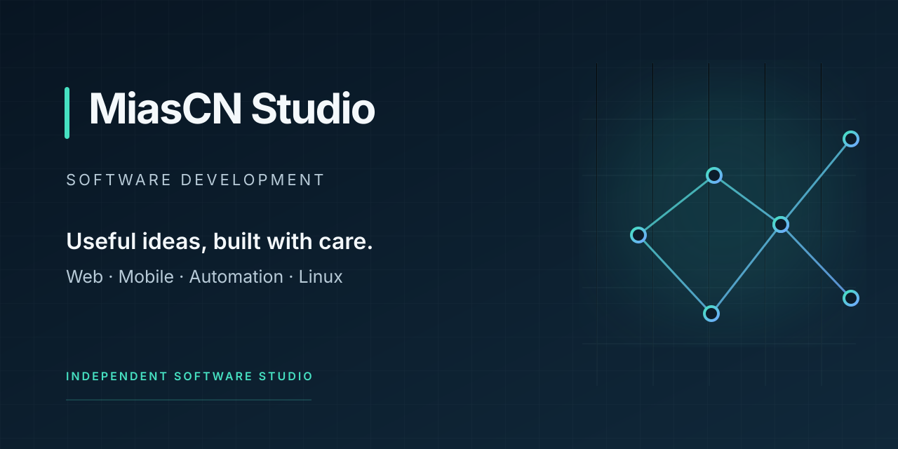

# MiasCN Studio

**Desarrollo de software para resolver problemas reales.**  
**Software development for practical, real-world problems.**

Estudio independiente de desarrollo enfocado en aplicaciones web y móviles, sistemas para negocios y automatización.

Independent software studio focused on web and mobile applications, business systems, and automation.

[Proyectos / Projects](#proyectos--selected-work) · [Servicios / Services](#servicios--services) · [Forma de trabajo / How I work](#forma-de-trabajo--how-i-work) · [Contacto / Contact](#contacto--contact)

---

## Proyectos / Selected work

### [Los Olivares](https://github.com/MiasCNStudio/LosOlivares)
Sistema de gestión para un agroservicio, con inventario, ventas y entradas. Proyecto desarrollado con Laravel y PHP.

Management system for an agricultural supply store, covering inventory, sales, and stock entries. Built with Laravel and PHP.

### [Asociación Comunal](https://github.com/MiasCNStudio/AsociacionComunal)
Proyecto de equipo para administrar una asociación comunal salvadoreña. Mi aporte incluyó coordinación del equipo y desarrollo en frontend, backend y aplicación móvil.

Team project for managing a Salvadoran community association. My contribution included team coordination and development across the frontend, backend, and mobile app.

**Tecnologías / Technologies:** Java, JavaFX, Javalin, MySQL, Flutter, Dart.

---

## Servicios / Services

- Desarrollo web / Web development
- Aplicaciones móviles / Mobile applications
- Bases de datos y SQL / Databases and SQL
- Python y automatización / Python and automation
- Soporte técnico y Linux / Technical support and Linux

## Forma de trabajo / How I work

1. Acordamos el problema, los objetivos y quién usará la solución. / Align on the problem, goals, and users.
2. Definimos entregables, alcance, fechas y presupuesto. / Define deliverables, scope, timeline, and budget.
3. Compartimos avances y revisamos los puntos clave. / Share progress and review key decisions.
4. Probamos los requisitos acordados y documentamos la entrega. / Check the agreed requirements and document the handoff.

## Contacto / Contact

Para conversar sobre un proyecto, abre una consulta en GitHub con el objetivo, el plazo deseado y el alcance que tienes en mente.

For project inquiries, open a GitHub discussion with the goal, desired timeline, and scope you have in mind.

**GitHub:** [@MiasCNStudio](https://github.com/MiasCNStudio)
